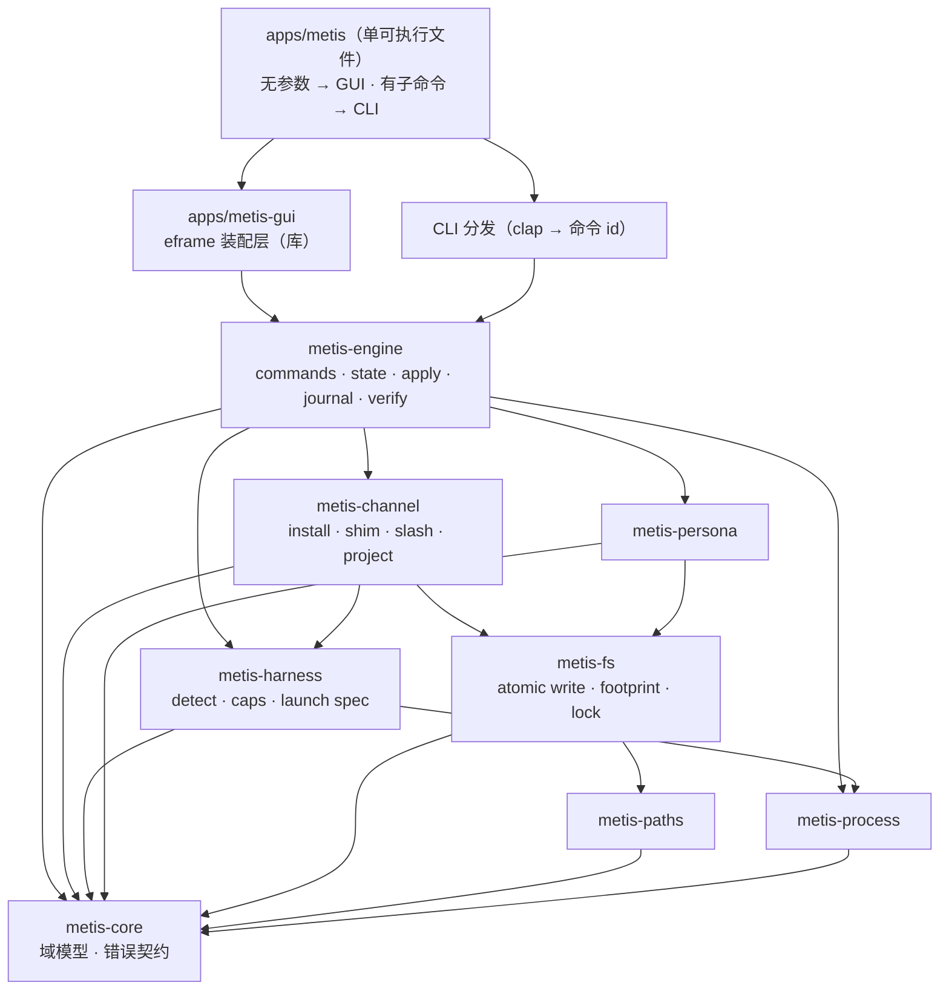

# 架构

> 相关：[功能对齐](PARITY.md) · [执行器矩阵](HARNESS-MATRIX.md) · [磁盘格式](DATA-FORMAT.md) · [界面规格](UI.md) · [测试](TESTING.md)

> 状态：设计已定，代码未落地（M0）。文中标注 `未确认` 的地方表示还需要在 M1 用实测补齐。
> 功能基线：agent-purge v0.2.19。逐项对齐见 [`PARITY.md`](PARITY.md)。

## 1. 总览

Metis 是一个**短生命周期、本地、无守护进程**的工具。它做三件事：

1. **记账**：把"用户选了什么"写成一份状态文件（`~/.metis/state.json`）。
2. **落盘**：把"用户选了什么"翻译成每家 coding agent 能读到的形式（配置文件、PATH 前置命令、插件源码、
   项目规则文件），并且**只写自己能回滚的部分**。
3. **启动与验证**：按人设启动宿主进程；在需要时用本地假 provider 抓真实请求，证明人设确实进了 system 层。

它**不做**的事：不常驻、不开监听端口（验证用的假 provider 是临时进程内服务，只绑 `127.0.0.1`，用完即关）、
不代理宿主的模型请求、不修改宿主二进制（基线里 `claude` / `zcode` / `antigravity` 的二进制补丁路线在 Metis
中默认不提供，见 §13）。



依赖只允许向下。`cargo xtask layers` 读每个 crate 的 `Cargo.toml` 强制这条规则。

## 2. 分层与 crate 职责

| crate | 层 | 职责 | 明确不做 |
|---|---|---|---|
| `metis-core` | L0 | 域类型与错误：`HarnessId`、`Mode`、`Channel`、`PersonaId`、`Activation`、`Effect`、`MetisError`。纯数据 + 纯函数 | 不碰文件系统、不读环境变量、不起进程 |
| `metis-paths` | L0 | 路径解析：`~/.metis` 布局、各 harness 主目录与环境变量（`CODEX_HOME`、`PI_HOME`…）、shim 目录 | 不创建文件（只给路径）；根必须可注入 |
| `metis-fs` | L0 | 原子写、备份、所有权凭据（footprint）、控制锁、逐字节比较 | 不懂 harness 语义 |
| `metis-persona` | L1 | 人设：front-matter 解析/序列化、列表、`active.md` 物化、导入（目录 / GitHub）、内置模板 | 不写宿主配置 |
| `metis-harness` | L1 | 执行器适配：`Harness` trait、探测、能力表、启动参数、静态元数据与落点表 | 不直接写盘 |
| `metis-channel` | L1 | 四条通道的 `plan / apply / revert / status`，以及宿主侧 JS/TS 产物的生成 | 不决定"该不该做"（由 engine 决定） |
| `metis-process` | L2 | 外部进程：超时、stdin 策略、输出上限与排空、进程组/Job Object 终止；本地假 provider | 不知道被谁调用 |
| `metis-engine` | L2 | 命令注册表、`state.json`、激活解析、apply 编排、journal、verification、armor、doctor、update、**远端 Hub 客户端与导入（注入式网络 + ETag 缓存 + `skills/`）** | 不依赖任何 UI 类型 |
| `metis-ui-egui` | L3 | egui 界面：屏幕、组件、主题、后台任务绑定 | 不含业务判定；不直接读写宿主配置 |
| `metis-testkit` | dev | 临时 home、假 harness 可执行文件、假 provider、golden 比对 | 不进生产二进制 |
| `apps/metis` | app | **单可执行文件入口**：无参数 → GUI，有子命令 → CLI；CLI 只做 clap 解析 → 命令 id + 参数 → engine | 不实现业务；CLI 路径不初始化 GUI |
| `apps/metis-gui` | app | GUI 装配层（库）：窗口、图标、字体、DPI、启动守卫；由 `apps/metis` 调用，不单独产出 exe | 同上 |

**为什么把 harness 与 channel 分开**：一家 harness 支持哪些通道是它的属性（能力表），而通道怎么落盘是通用机制。
分开之后，新增一家 harness 只写一个文件，改动绝不碰通道实现；新增一条通道也只写一个文件，改动绝不碰 15 家 harness。
这是"扩展走接缝"的具体落点，也是基线里 `caps.mjs` + `persist.mjs` + `slashes.mjs` 三处真相必须合并的地方。

## 3. 域模型（`metis-core`）

```rust
/// 处理模式。与基线的字符串值一一对应，序列化时保持原样。
pub enum Mode { Replace, Strict, Append, Off }

/// 通道。ARMS 的顺序即优先级顺序。
pub enum Channel { Shim, Slash, Install, Project }

/// 执行器标识。开放集合：内置 15 家 + 未来新增，比较用字符串 id。
pub struct HarnessId(String);

/// 一次解析的结果：这家到底该不该注入、以什么身份注入、为什么被拦下。
pub struct Activation {
    pub persona: Option<PersonaId>,
    pub mode: Mode,
    pub configured_mode: Mode,
    pub on: bool,
    pub source: Option<ActivationSource>, // ExplicitLaunch | Resident | SessionCommand | Auto
    pub blocked_by: Option<BlockReason>,   // 见 §4.2
}

/// 生效时机，用于 UI 文案与报告字段。
pub enum Effect { NextTurn, NextLaunch, NextSession }
```

错误契约：

```rust
pub struct MetisError {
    pub kind: ErrorKind,
    pub message: String,          // 面向用户，中文
    pub remediation: Option<String>, // 补救建议：具体到能照做的命令或动作
    pub cause: Option<Box<MetisError>>,
}
```

`ErrorKind` 至少覆盖：`Io`、`StateCorrupt`、`LockHeld`、`UnknownHarness`、`UnknownChannel`、
`UnsupportedChannel`、`PersonaMissing`、`RestoreConflict`、`ExternalModification`、`ProcessFailed`、
`ProcessTimeout`、`ProgramMissing`、`Network`、`UpdateFailed`、`Internal`。

**规则**：任何面向用户的失败都有 `remediation`；测试断言 `remediation` 非空（除了确实无事可做的内部错误）。
基线的错误文案是产品的一部分（用户在 issue 里贴的就是它），`PARITY.md` 逐条登记。

## 4. 状态与激活语义（`metis-engine`）

### 4.1 `state.json`

`~/.metis/state.json`，版本字段 `v`，当前 `1`。字段与基线一致（这是对齐的关键面）：

| 字段 | 类型 | 含义 |
|---|---|---|
| `v` | int | 格式版本 |
| `persona` | string? | 全局人设 id |
| `default` | `{harness, mode}`? | 裸敲命令时启动谁；`mode` 同时是总电源 |
| `armed` | `{harness: [channel]}` | 每家武装了哪些通道 |
| `overrides` | `{harness: {persona?, mode?}}` | 分家例外 |
| `projectDirs` | `{harness: [dir]}` | 已登记的项目目录（绝对路径） |
| `disabledHarnesses` | [string] | 单家整家停用 |
| `pausedInstalls` | [string] | 暂停期间选择但未落盘的 install |
| `prevMode` | Mode? | 恢复时回到哪个模式 |
| `activationEpoch` | uuid? | 全局 off→on 时重新生成，防止旧插件复活。**缺省语义值是字符串 `"initial"`**，不是 `null` |
| `harnessEpochs` | `{harness: uuid}` | 单家 off→on 时重新生成；同上，缺省 `"initial"` |
| `lastApply` | ApplyReport? | 最近一次应用报告 |
| `dshProfiles` | [string]? | DSH 要处理的 profile 白名单 |
| `dshRuntime` | `{profile: {enabled}}` | DSH `/purge` 的运行时开关 |
| `piAuto` / `ompAuto` | bool | 扩展的自动注入开关 |
| `piUserLayer` | bool | 基线里的 pi 用户层开关（对齐状态见 `PARITY.md`） |

落盘必须原子（临时文件 + rename），权限 `0600`，末尾换行。损坏时**保留原字节**并报错停下，不"尽力修复"。

### 4.2 激活解析（判定顺序即产品语义）

`resolve_configured(state, harness)` → `{persona, mode, persona_from, mode_from}`：
分家例外优先，否则跟随全局。

`resolve_activation(state, harness, ctx)` 按**这个顺序**短路（顺序不能改，改了就是行为差异）：

1. `state` 不是对象 → `missing-state`
2. `state.default.mode == Off` → `global-pause`
3. `state.overrides[harness].mode == Off` → `harness-off`
4. `harness ∈ state.disabledHarnesses` → `harness-disabled`
5. `ctx.session == false` 或 `ctx.enabled == false` → `session-off`
6. `ctx.profile` 存在且不在 `state.dshProfiles` 里 → `profile-off`
7. `mode ∉ {Strict, Replace, Append}` → `mode-off` 或 `invalid-mode`
8. 没有任何通道/来源提供许可 → `not-enabled`
9. 否则 `on = true`，`source` = `explicit-launch` / `resident` / `session-command` / `auto`

第 8 步的"许可来源"与基线一致：显式启动 > `install` 通道已武装 > `slash` 通道已武装且（会话内命令 或
`state[harness+"Auto"] == true`）。

**关键不变式**：环境变量、命令行 token、`FORCE` 之类的输入**永远不能**直接把 `on` 变成 true；
只有经过进程归属核验的显式启动路径可以传 `launch: true`。这条有专门的安全测试（对应基线 `test/safety.test.mjs`）。

### 4.3 epoch 语义

全局或单家从 `off` 变回非 `off` 时，重新生成对应的 epoch UUID。插件每个回合核对 epoch：epoch 变了，
说明中间发生过一次关闭，旧回合残留的注入不再被当作有效。**epoch 只增不减，清空即视为可疑**；
两个字段的缺省值是字符串 `"initial"`（不是空值），所以"没有先后之分"这件事本身也要能表达。

## 5. 应用编排（`apply`）

一次 apply 是一个**事务**：全程持有控制锁，读 state → 解析 → 逐格执行 → 写回 state + 报告。
CLI 与 GUI 走的是同一个函数，不存在两套语义。

顺序（照抄基线，因为顺序本身是行为）：

1. 先计算 `mode`：`options.mode` > 全局 `default.mode`；`enabled == false` 直接 `off`；
   全局已暂停且本次没有显式 `enabled == true` 时保持 `off`。
2. 先只把 `{default.mode, prevMode}` 落盘（**先发布 off**）。这样即使后面的静态清理由某一家失败，
   动态通道也已经停止。
3. 逐 `harness × channel` 执行，每格产生一条结果：
   `{harness, channel, status, action, effect, error?, persona?, mode?, file?}`。
   - `install`：`off` 且非动态通道 → `uninstall`；`off` 且动态通道 → `disabled-by-state`；否则 `install`。
   - `slash`：`off` → `disabled-by-state`；否则安装会话命令扩展。
   - `shim`：`written`（内容在启动时读取，所以是 `reads-on-launch`）。
   - `project`：按登记的目录逐个处理；没有登记目录 → 明确失败并让用户重新指定。
4. `mode == off` 且不是重试时，额外扫描磁盘上**仍然存在**的托管块，清掉旧版本遗留（不扩大恢复范围）。
5. 写回 `pausedInstalls` 与 `lastApply`。

`ApplyReport`：

```rust
pub struct ApplyReport {
    pub id: Uuid,             // 唯一，可被 UI 引用
    pub at: OffsetDateTime,
    pub revision: String,     // sha256(persona_id, body, mode) 前 16 位十六进制
    pub persona: Option<PersonaId>,
    pub mode: Mode,
    pub ok: bool,
    pub partial: bool,        // 有失败也有成功
    pub results: Vec<ChannelResult>,
    pub runtime_confirmed: bool, // 恒为 false：写入成功 ≠ 运行时生效
}
```

`runtime_confirmed` **只在真机抓包证明后**由 verification 的持久化结果驱动，不由 apply 自己置位。
这是铁律 4 的代码化。

### 5.1 只重试失败项

`only_failed` 从 `lastApply` 里取出 `status == failed` 的格子，只重跑这些格子。project 通道额外按 `file`
匹配，避免"重试失败项"却把已成功的目录再写一遍。

## 6. 通道模型（`metis-channel`）

```rust
pub trait ChannelImpl {
    fn id(&self) -> Channel;
    /// 是否会改动磁盘（shim 的 apply 只是生成命令文件；project 每个目录一格）
    fn plan(&self, ctx: &ChannelCtx) -> Result<ChannelPlan, MetisError>;
    fn apply(&self, ctx: &ChannelCtx) -> Result<ChannelOutcome, MetisError>;
    fn revert(&self, ctx: &ChannelCtx) -> Result<ChannelOutcome, MetisError>;
    fn status(&self, ctx: &ChannelCtx) -> Result<ChannelStatus, MetisError>;
}
```

- **install（配置/插件常驻）**：按 harness 的落点表写文件。三种写法：
  - *托管块*：在既有文件里插入带起止标记的块（`AGENTS.md`、`CLAUDE.md`、`SOUL.md` 等）；
  - *结构化字段*：改 JSON/TOML 的某个键（`settings.json` 的 `personalization.customPrompt`、
    `config.toml` 的 `model_instructions_file`）；
  - *整文件替换*（仅当该文件是宿主专属、且回滚凭据完整时）。
- **shim**：在 `~/.metis/shim/` 放同名可执行包装（Windows `.cmd`、Unix shell 脚本），由用户把该目录放进 `PATH`
  最前面。包装脚本不内嵌人设，只转发到 `metis launch <harness>`，人设在启动时读取。
- **slash**：安装会话内 `/purge` 扩展（pi / omp / dsh / pi-desktop）。产物是宿主语言的源码（见 §8）。
- **project**：在登记的绝对路径下的 `AGENTS.md` / `CLAUDE.md` / `CODEBUDDY.md` 里写托管块；删块即逐字节还原。

**通道能力只在一处判定**：`metis-harness` 的能力表给出 `{ok, why}`，`metis-engine` 在 apply 前查表，
UI 直接展示 `why`。UI 里不得出现自己写的"这个大概能用"。

## 7. 所有权与恢复（`metis-fs`）

这是整个项目最重要的机制：**能安全撤销，才敢写别人的文件**。

### 7.1 所有权凭据（footprint）

每次写盘前记一条：

```rust
pub struct Footprint {
    pub path: PathBuf,
    pub kind: FootprintKind,   // ManagedBlock | WholeFile | StructuredField | GeneratedFile | Shim
    pub before_hash: Option<String>,  // 写入前的 sha256；文件原本不存在则 None
    pub before_bytes: Option<BlobRef>, // 需要整文件回滚时保存原件（放 ~/.metis/backups/）
    pub block_marker: Option<BlockMarker>, // 托管块的起止标记
    pub owned_text: Option<String>,        // 我们写进去的确切文本，用于二次校验
    pub written_at: OffsetDateTime,
    pub generator: String,     // 产出它的模块与版本，便于诊断
}
```

判定"这份写入还是我们的吗"用**内容相等**（哈希或逐字节），不用时间戳、不用大小。

### 7.2 回滚规则

- 只回滚**我们写过的**：块标记存在且内容与 `owned_text` 一致 → 删除块；整文件替换 → 写回 `before_bytes`。
- **四道防线**，依次判定：① stash 里保存的原字节；② 账本里的 sha256 指纹；③ 内容里的托管标记
  （`looks_owned`）；④ 三者都不成立 → 一律不动，记为 `skipped-foreign` 并出现在报告里。
- 外部修改过 → **保留现状**，返回 `RestoreConflict`，报告文件名、差异位置、原始备份路径，
  **绝不删除备份**。若该文件原本由我们托管、但现在内容已不是我们的，**改名停用而不是删除**
  （例如加 `.disabled-by-metis` 后缀）并在报告里说明，让用户自己决定。
- 文件已经不存在 → 视为已经还原，记 `already-clean`，不算失败。
- 任何一步失败 → 停止该文件的后续操作，**保留全部恢复材料**，在报告里给出可复制的路径。

**撤销方式必须是封闭集合**：`undo.type` 的取值是受限枚举（`block` / `whole-file` / `field` /
`generated` / `path` / `file-delete` / `path-env`），匹配必须穷尽。遇到不认识的值 → 报错并**保留账本**，
不猜测、不丢弃。（基线上就有一次真实事故：某个模块写入了 `file-stash`，而清理逻辑不认识它，
结果是清理直接抛错、账本被迫留下。Metis 用穷尽匹配 + 一条"未知 undo 类型"的测试防住它。）

### 7.3 安全闸门（破坏性操作前的硬拒绝）

`clean`（撤回全部写入）与 `self-uninstall`（删除数据目录）在执行**任何**写操作与建锁**之前**先过闸门。
命中任一条即拒绝，并说明命中了哪一条：

- 当前工作目录在数据目录**之内**（很可能是误操作，或数据目录被当成项目目录）；
- 数据目录解析结果等于用户主目录、临时目录，或是它们的**上级目录**；
- 数据目录的 basename 为空（例如 `C:\` 或 `/`）、是盘符根、或只是分隔符；
- 数据目录不存在但它的父目录不存在（说明路径本身算错了）。

`self-uninstall` 没有 `--yes` 也没有 `--dry-run` → 退出码 2 并打印警告。
`clean` 在有残留时**保留原数据目录**供重试，不"尽力删除"。
shim 目录只在**它为空**时才删除。

### 7.4 控制锁

跨进程互斥，落在 `~/.metis/.apply.lock`：

1. `open(O_CREAT|O_EXCL)` 成功 → 拿到锁，写入 `{pid, token, at}` 并 `fsync`。
2. 已存在 → 读 owner；用 pid 存活探测判断是不是死锁：
   - `ESRCH`（进程不存在）**且文件内容两次读一致** → 删掉死锁文件重试一次；
   - 否则报 `LockHeld`，带上 owner pid 与锁文件路径。
3. 同进程内可重入（同一根路径的嵌套调用复用已持有的锁）。
4. 释放：只有 `token` 匹配才删除；`finally` 语义在 Rust 里用 RAII `Guard` 实现。

**为什么不用 `flock`/`LockFileEx`**：基线的语义是"能识别并回收死锁"，而且要求锁文件内容可诊断。
用同一个算法移植，行为可对齐，测试可复现。

## 8. 宿主侧产物（生成的 JS/TS）

**这是 Rust 化最容易漏掉的一点**：四条通道里有两条（`slash` 与部分 `install`）要求宿主加载的是
**JavaScript / TypeScript 源码**——DSH 的 cordis 插件、OpenCode v1/v2 插件、pi 的扩展、会话内 `/purge` 命令。
Metis 自己不运行 JS，但**必须生成这些文件**。

设计（已落地，见 `crates/channel/src/slash.rs`）：

- 模板是本仓库自己的源码，放在 `crates/channel/assets/host/`，用 `include_str!` 嵌入二进制：
  - `runtime.mjs` — 共用运行时（激活解析、模式重写、来源记录、幂等、失败降级）；
  - `slash-extension.mjs` — pi / omp / pi-desktop 的扩展；
  - `opencode-v1.mjs` / `opencode-v2.mjs` — OpenCode 两代插件 API；
  - `dsh-plugin.mjs` — DSH 的 cordis 插件。
- **占位符只有两个**：`__METIS_HOME__` 与 `__METIS_HARNESS__`，都在生成时做 JS 字符串转义
  （反斜杠、引号、换行、`<>`）。别的一律编译期确定。
- **产物不内嵌人设正文**：只记录路径，运行时才读。否则换个人设就得重装扩展。
- **幂等靠来源记录**（`createProvenance`）：宿主会把我们改过的内容下一轮再交回来，所以改写
  必须"先还原成 before、再重新算、再记录"，否则会越叠越多。同一个 after 对应两个不同 before
  时标为歧义，**歧义就不动**。
- **失败一律降级**：所有入口都包 `try/catch`；读不到配置就当"没有配置"；扩展绝不把宿主搞挂。
- 产物路径、内容、哈希都进 footprint，因此可以逐字节回滚（`disarm` 只删我们自己的文件）。
- 数据目录差异：产物读 `~/.metis/state.json`（或 `METIS_HOME`），不读 `~/.agent-purge/`。

**测试策略（关键）**：语法检查不够。除了 `node --check` 验证产物语法，还有
`assets/host/runtime.behaviour.mjs` —— 由 `cargo test` 通过 node 执行，直接跑运行时真实函数，
断言四种模式、九步激活、幂等、**以及"状态文件损坏时降级为不注入"**。34 条断言。
（`PITFALLS.md` G13：语法对但语义错，只有跑起来才知道。）

## 9. 进程模型（`metis-process`）

统一入口，禁止别处直接 `std::process::Command`（由 `xtask layers` + clippy 自定义 lint 兜底）。

- 依赖：`process-wrap`（`std`、`process-group`、`job-object`、`kill-on-drop`、`creation-flags`）。
  Windows 用 Job Object，Unix 用进程组，保证**子孙进程一起消失**，不留孤儿。
- 每次执行都有两个截止时间：墙钟总时长 + 空闲时长（无输出）。
- stdout/stderr 由独立线程持续排空并计入上限；超上限只保留头尾并标记截断。
- stdin：默认关闭；需要喂输入时给管道，**绝不继承**。
- 退出判定：程序缺失（`NotFound`）→ `ProgramMissing` 并给安装建议；非零退出 → `ProcessFailed` +
  摘要（不是全部输出）；超时 → `ProcessTimeout` 并说明已终止进程组。
- 取消：GUI 的取消按钮 → `CancellationToken` → 组合进 `kill-on-drop`。
- 测试用 `testkit` 的假可执行文件（在临时目录里生成一个能按参数睡/打印/吃 stdin 的小程序），
  不依赖任何真实 harness。

## 10. 命令注册表与 UI 契约

**一切皆命令**：`metis-engine::commands` 里每个用户可见行为都是一个实现 `Command` 的类型：

```rust
pub trait Command: Send + Sync {
    fn id(&self) -> &'static str;                 // 稳定标识，CLI/GUI/文档共用
    fn title(&self) -> &'static str;              // 中文标题（UI 用）
    fn params_schema(&self) -> schemars::Schema;  // 参数结构（GUI 自动表单、文档生成）
    fn effects(&self) -> Effects;                 // 会写哪些路径、是否会起进程、是否需要网络
    fn run(&self, ctx: &EngineCtx, params: &serde_json::Value) -> Result<CommandOutput, MetisError>;
}
```

- `apps/metis` 把 clap 的解析结果转成 `{id, params}`，不做自己的业务分支。
- `metis-ui-egui` 通过同一个注册表调用；界面上的"应用/暂停/武装/导入"都是命令调用。
- 命令 id 与 CLI 子命令名的映射登记在 `PARITY.md`，`cargo xtask ci` 校验"每个 CLI 子命令对应一个已注册命令"。

**后台任务模型**（GUI 不阻塞的关键）：

```rust
pub struct JobRunner { /* 线程池 + mpsc */ }
pub enum JobEvent { Started(JobId), Progress(JobId, Progress), Done(JobId, CommandOutput), Failed(JobId, MetisError) }
```

- 每个可能慢的命令都返回 `JobId`；UI 只持有 `JobId` 与最近一次 `JobEvent`。
- 每个任务可 `cancel()`；不可取消的（例如正在 rename）标 `uncancellable` 并在 UI 里说明。
- 慢操作清单（必须在后台跑）：探测（15 家 PATH 扫描）、apply、verify/capture、update 检查与下载、
  导入人设、doctor、armor。

## 11. 验证与观测

| 能力 | 做什么 | 落盘 |
|---|---|---|
| `detect` / `doctor` | 扫 PATH 与已知安装目录，给出每家的可执行文件、版本、主目录、标记文件 | 内存 + CLI 输出 |
| `verify` | 起一个**进程内**假 provider（只绑 `127.0.0.1` 随机端口），用 `--base-url`/`--api-base` 之类参数启动 harness，抓请求体，判定人设是否出现在 system/developer 角色 | `~/.metis/verification/latest.json` |
| `armor` | 测量矩阵：`plan` / `preflight` / `run` / `judge`，产热力图 | `~/.metis/armor/*.json` |
| `journal` | 每次写的追加日志（谁、何时、哪个文件、哪个块、哈希） | `~/.metis/journal/*.jsonl` |

验证报告结构（对齐基线，`verify` 与 GUI 的诊断页共用）：

```json
{ "v": 1, "at": "...", "results": [
  { "harness": "codex", "status": "ok|missing|failed", "where": "system|developer|user|none",
    "chars": 1234, "requests": [ /* 抓到的请求摘要，正文做长度截断 */ ] } ] }
```

**隐私**：抓到的请求体可能在正文里含用户人设，落盘前只保存**判定所需的最小信息**（角色、长度、是否命中、
前若干字符的标记串），不保存完整正文。这条有专门测试。

## 12. 关键不变式（每条都有对应测试）

| # | 不变式 |
|---|---|
| I1 | 任何通道 `apply` 后再 `revert`，目标文件**逐字节**回到初始状态 |
| I2 | `apply` 幂等：连续两次 apply，第二次的所有磁盘哈希不变 |
| I3 | 外部修改过的托管文件，`revert` 不覆盖、不删备份，返回 `RestoreConflict` 并指出路径 |
| I4 | 任何失败路径都不会删除 `/backups/` 下的恢复材料 |
| I5 | `resolve_activation` 的 9 步短路顺序固定，且输入 token/环境变量不能让 `on` 变 true |
| I6 | `state.json` 损坏 → 原文件字节不变，返回 `StateCorrupt` |
| I7 | 全局 `off` 压过任何分家例外（`override.mode` 不能反过来开启） |
| I8 | apply 报告里 `runtime_confirmed` 只可能被实测结果置位，apply 自身永远写 false |
| I9 | CLI 与 GUI 调用同一个命令实现：同一参数下磁盘结果字节一致 |
| I10 | 每个 CLI 子命令都能在 `--dry-run`/`--help` 下不写盘、不起进程 |
| I11 | 外部进程在超时/取消/drop 后，其进程组内没有遗留进程 |
| I12 | 测试进程不读不写真实 `$HOME`（由 `testkit` 强制 + 一条真实 HOME 只读断言） |
| I13 | 生成的宿主产物与 golden 文件一致；不一致即测试失败 |
| I14 | `Effect` 的取值与通道一致：shim → next-launch、slash → next-turn、project → next-session |
| I15 | 能力表里每个 `why` 都非空且被测试覆盖（说得出为什么不能用） |

## 13. 与基线的有意差异（完整清单在 `PARITY.md`）

| 差异 | 理由 |
|---|---|
| 数据目录 `~/.metis/` 而非 `~/.agent-purge/` | 明确的产品隔离；提供 `metis import agent-purge` 一次性导入 |
| 控制台是 egui 桌面窗口，不是本地 Web 服务 | 去掉端口占用、浏览器生命周期、CSRF/同源、刷新退出倒计时四类问题；不再需要监听 |
| 不提供二进制补丁路线（`claude` 的 62 字身份句、`zcode` 的 `zcode.cjs`、`antigravity` 的 `language_server.exe`） | 修改第三方二进制会破坏签名与自动更新，风险高于收益；这些路线在 UI 中显示为"不支持"并说明原因 |
| 不提供 npm / 安装器 / ZIP 三条分发路径中的两条 | Rust 单可执行文件即可；只保留安装器（可选）与便携包 |
| 生成的宿主插件读 `~/.metis/state.json` | 数据目录差异的直接结果 |
| 不提供 Playwright 浏览器端测试 | 没有浏览器端；等价覆盖由 `egui_kittest` 无头界面测试承担 |
| `pull` 拉取人设的默认仓库、`matrix.json` 的角色 | 重新设计为内置类型化数据表；具体形态见 `PARITY.md` 的 decision 条目 |
